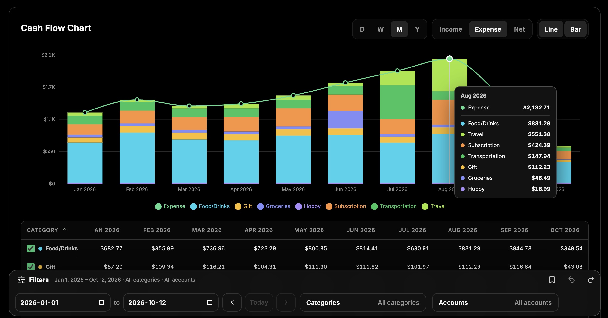
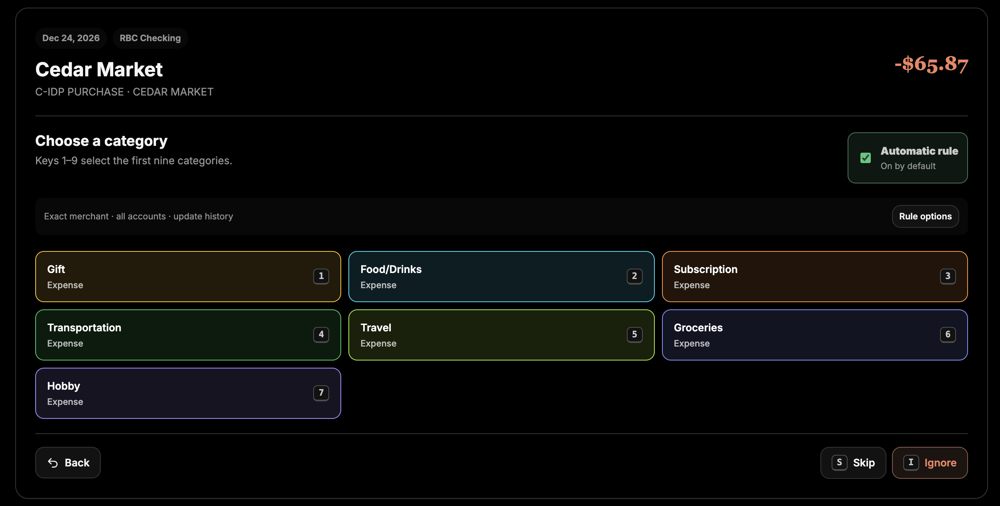
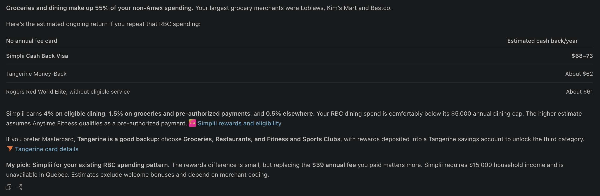

I've been working on an expense tracking app called Budgies (named after a burrito restaurant in my neighborhood). The idea came from a conversation with my close friend and colleague Jamshid, who suggested that I track my expenses to better understand where my money was going and set a budget so I could feel less guilty about spending as long as I stayed within budget.

I started by downloading my bank and credit card statements and generating parsers to extract transactions from CSV/PDF files. The transactions are then saved to the database and displayed in the web app as charts and tables, allowing me to see both my overall spending trends and individual purchases.

One of the first features I added was categorization. I wanted to understand how much I was spending on eating out, groceries, transportation, subscriptions, etc (the list has since grown to 16 categories). There's some manual work in the beginning because you have to categorize each transaction, but the app remembers the category and automatically applies them to future transactions from the same merchant, so there's less to categorize manually over time.

I then spent a lot of time iterating on the expense chart. As I was building it, I realized that what I wanted was similar to the monitoring tools I use at work like AWS CloudWatch and New Relic, so I used them as references. I wanted to be able to quickly adjust date ranges, filter by category, navigate back and forth in time, and save filters I frequently use. When I hover over a data point, I can see a breakdown of spending by category, ordered from highest to lowest, making it easy to see where most of my money went in a given month.

This was all great, but it wasn't particularly useful for budgeting because I was only importing bank statements at the end of each month, so I wouldn't know how much I'd spent until after the fact. I needed a way to get real time transaction updates so I decided to integrate Plaid, which is a banking API that can hook into your accounts. 

Integrating Plaid wasn't as simple as I'd expected. Codex initially came up with an unnecessarily complicated implementation plan involving services, database tables, and additional logic that I didn't need. Part of the problem was that the app had originally been designed around file imports, but the codebase had also become bloated enough that Codex struggled to make good design decisions without me constantly nudging it to simplify things. I took this opportunity to clean things up by removing orphaned database tables and columns, deleting unused API endpoints, simplifying business logic, and adding tests. The cleanup made this a bigger task than I'd originally planned, but it also gave me a chance to dive back into the code after weeks of vibe coding and get a better grasp of how everything worked.

The latest feature I worked on was giving Codex access to my transaction history through MCP so it could analyze my spending and draw insights from it. For example, I asked Codex to help me find a Visa credit card that would earn me the most rewards based on my spending patterns. It was able to look up my non-Amex transactions and suggest several credit cards along with estimates of how much I could earn in points or cashback with each. I initially tried to connect the MCP server to ChatGPT, but it wasn't straightforward, so I ended up using Codex instead. Codex could have done the same by querying the database directly, but using MCP is better because I can control what data it can access and what actions it can perform.

It's been about two months since I started building Budgies and I've been gradually improving it as I use it. I'm not building anything particularly novel, but it's satisfying to have an app that fits my needs and works exactly the way I want it to. It's also free, customizable, and runs locally, so I don't have to share my financial data with others with the exception of Codex if I decide to use the MCP.

## What's next

Now that I have a pretty solid foundation, the next step is to build the budgeting feature that motivated me to start this project in the first place. I'd like to set a monthly budget for each category and track my spending against it so I can see how much I have left to spend throughout the month.

I'm also thinking about linking my savings and investment accounts so I can build a balance sheet alongside my cash flow statements. That way, I could see not just where my money is going, but also how my overall financial position is changing over time.

Another idea that came from Jamshid is adding financial projections. Right now, the app only looks at historical data, but I could use that data to project my finances into the future so I have a better idea of how much money I might have in 5 or 10 years and plan for retirement.

## Things I'd do differently

One thing I regret is not using a design system or component library from the beginning. I've ended up with a large CSS file that's become tedious to maintain, and the UI seems to break every time Codex makes changes to the frontend. I wish I'd been more intentional about design from the start because I now spend more time than I'd like fixing UI issues. At this point, I'm hesitant to migrate to a design system or component library because I've already built a lot of custom logic. Instead, I'd like to start by adding Playwright e2e tests for key user journeys and visual snapshots to catch unintended UI changes, so Codex can identify and fix issues without me having to manually check the UI every time.

Another thing I want to experiment with is having Codex handle refactoring and cleanup tasks overnight while I'm sleeping. Ideally, it would identify areas for improvement, prioritize them, assess the risks, and work through the changes in a loop, running tests after each step to make sure nothing breaks. I'd love to wake up to a cleaner codebase so I can spend more time building features. I think this should be doable, and it's similar to what a lot of companies are trying to achieve with software factories.

## Architecture Diagrams
