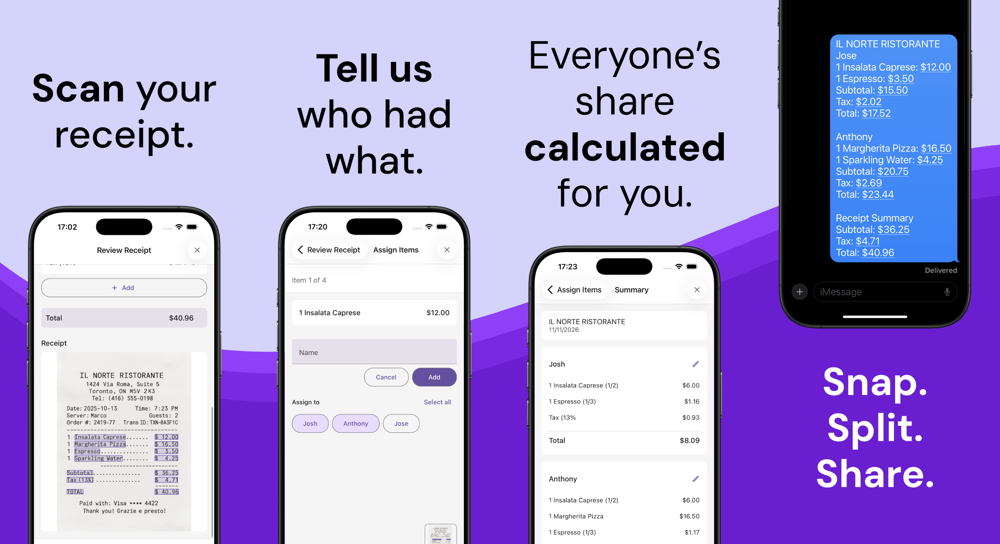
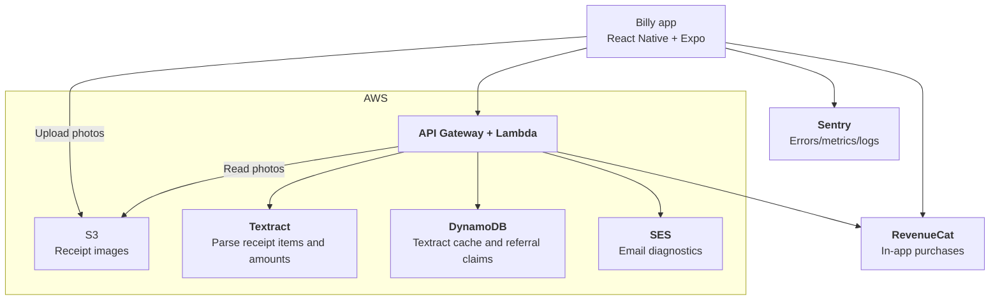

## Project status: Active

- Released in April 2025 ([Available on iOS](https://apps.apple.com/ca/app/billy-split-bills-instantly/id6736915357))
- 294 first-time downloads
- 11 purchases from Canada, the US, Mexico, Egypt, and the Maldives (CAD $42)

*As of November 2026*

## Why did I build it?

When I lived in Toronto, there were many occassions where restaurants (mostly asian) would only accept one bill for the group and I had to figure out the split after coming back home. It was tedious and time consuming because I did not remember who had what and I had to also figure out how to split taxes and tips. I had wished there was an easier way to figure out how much each person owed. That's why I built Billy which is an app that scans your receipt and calculates the split for you right away. This page explains how I built the app in detail.

## Architecture
Billy is a React Native app built with Expo and a serverless backend on AWS. I chose serverless  to keep costs low. I had side projects before that I had to shut down because of inactivity and server costs. For Billy, I didn’t want to worry about keeping the app up even if there are no users. Textract costs me a cent per receipt scan. Lambda costs nothing because my usage is low enough to stay within the free tier. S3 and DynamoDB barely cost anything either. All in all, it costs me a dollar a month to keep Billy up.

The backend uses:

- API Gateway and Lambda for API requests
- Textract for parsing receipt images
- S3 for storing receipt images
- DynamoDB for caching OCR results and recording referral claims
- SES for emailing receipt diagnostics to myself

Besides AWS, I use Sentry for observability and RevenueCat for in-app purchases.

## How it works

### Upload and scan a receipt

When a user takes a picture of a receipt, the app asks Lambda for a presigned S3 upload URL. The app uploads the image directly to S3, then calls the receipt parser, which uses Textract to extract the items and amounts. I noticed that people sometimes uploaded the same image multiple times because it didn’t parse correctly. To avoid paying to scan the exact same image again, I hash the image and cache the result for a day. The real problem is that the receipt image is not clean for Textract to parse well. So I also added cropping and straightening to give the OCR a better image to work with.

### Split receipt items

After scanning, you review the result and assign each item to the people who ordered it. The app then calculates how much each person owes. This all happens on the phone and gets saved in AsyncStorage. You need internet to scan a receipt, but you don’t need it to split or view saved receipts later. Adding a tip used to be a required step, but after releasing the app, I noticed that people outside of US/Canada were also downloading the app so I made tipping an optional step and added a setting to hide it entirely.

### In-app purchases and free credits
The app has a pay-per-use model. When looking at similar apps that scan receipts, a lot of them had a subscription model, which did not sit well with me because this isn’t an app I need often enough to justify a monthly subscription. So I implemented a pay-per-use model where you only pay for the receipts you scan.

Each scan consumes 1 credit and redits can be purchased in packages of 5/10/20 for $2/$3/$4 respectively. Every new installation gets a free credit and users can get more free credits by referring the app to others. When someone claims a referral bonus, the backend checks the claim and records it in DynamoDB to prevent duplicate referral claims.

## Challenges

### Getting more downloads

My main challenge is getting more downloads. The app doesn’t rank well in keyword searches, so people have a hard time finding it. Only after releasing the app did I notice that there were apps with the exact same name offering the same features. Next time, I’ll do more research before picking my app name.

I’ve had about 33,000 impressions so far, but only 290 first-time downloads. That’s less than 1% conversion rate. To improve discoverability and conversion, I’ve tried the following:
- Tested various app titles and descriptions
- Updated screenshots to look more professional and explain the app better
- Added App Store descriptions in more languages after seeing downloads from outside the US and Canada
- Added translations and support for multiple currencies in the app

Lately, the conversion rate has improved to above 1%, but I think there’s still room for improvement.

### Receipt edge cases

I was surprised to see so many different types of receipts being uploaded in the beginning. It got to a point where there were more parsing failures than successes. I was getting receipts in different languages and formats. For example, some countries use three decimal places, and others swap commas and periods. Some receipts show the grand total in multiple currencies, and discounts can be applied per item or to the whole bill.

All these edge cases need to be accounted for because what Textract gives me is just a parsed string, and it’s up to me to figure out how to process it. That’s where most of my time went in the early days: fixing bugs. But I think a lot of the edge cases have been solved and the app is becoming more reliable. Every error is turned into a test case so it stays fixed and doesn't break again. When receipt parsing fails, I refund the credit to the user in hopes that they won’t feel like they’ve wasted money. They can always manually edit the line items, but it’s not an ideal experience.

### Design

I get compliments on the logo, but not on the UI/UX. I agree and that was intentional because I wanted to focus on making the app work reliably first. But now that I have the core features I wanted, I want to focus more on making the app feel fun and nicer to use.
