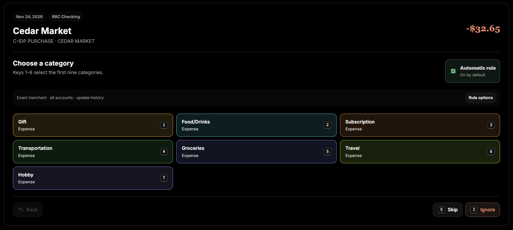
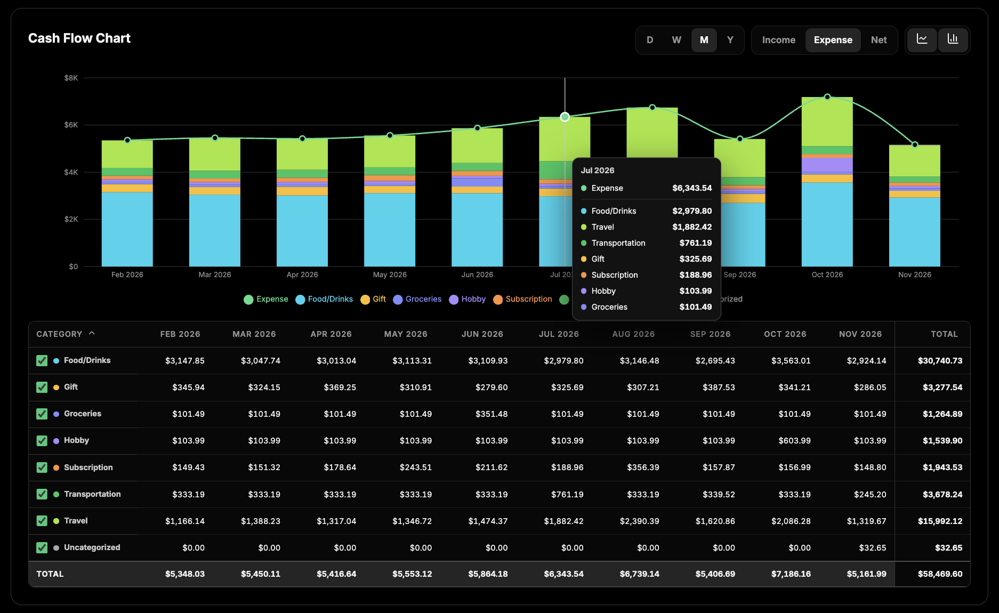
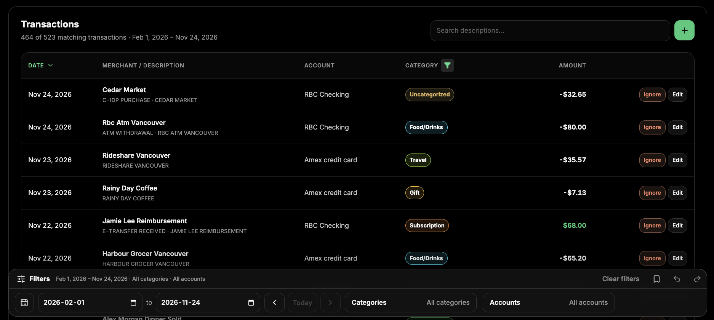



## Project status: Active

- First commit: August 2026
- Target Audience: me, app running locally
- 1,113 transactions logged

*As of November 2026*

## Overview

Budgies is an expense tracking app I created for myself. It's a web app built with React, Python, and SQLite that runs locally on my laptop. My goal was to make it easy to import transactions from my bank accounts and present them in a way that helps me understand how I spend my money.

## Why did I build it?

I think of myself as someone who doesn't spend much money, but my expenses were always higher than I expected. I must've spent it somewhere, but I never cared to look into it until a couple of months ago. I became curious about where my money was actually going.

There are plenty of apps that do this already, but I didn't want to pay for another subscription, nor was I comfortable sharing my financial data with anyone other than my bank.

So I built my own and named it Budgies, after a burrito restaurant in Vancouver. I chose the name because it sounds like "budget," but a budgie is actually a species of parrot, hence the bird logo.

## Journey of a transaction

Instead of talking about the technical details, I thought it would be more interesting to follow the journey of a transaction and explain how it ends up in Budgies.

Transactions can enter Budgies in one of two ways:
- Uploading bank statements (CSV/PDF)
- Automatically syncing with Plaid



Yes, I know I said I didn't want third parties seeing my transaction data, but I ended up integration with Plaid, which provides an API that lets you connect to your bank accounts. I initially relied on uploading bank statements, but I quickly realized that wasn't enough because I wanted to know how much I was spending in real-time, not weeks later when my bank statements became available.

Once transactions are imported from bank statements or Plaid, they're staged for review. I added this step because not every transaction was relevant to tracking my expenses, such as credit card payments and transfers to my investment accounts. The app also flags potential duplicates by checking whether a transaction with the same amount, date, and merchant already exists. This gives me a chance to filter out unwanted transactions before they make their way into the app.

When a transaction is approved, it starts showing up in the dashboard. Transactions are assigned categories so I can easily see how much I've spent on things like groceries, dining out, or transportation. I tried to make the categoriziation process as easy as possible by assigning keyboard shortcuts to the categories so I can quickly go through them. Whenever I assign a category to a transaction, the app creates a rule that remembers the category for that merchant so that future transactions from the same merchant are automatically categorized. It was a lot of work categorizing every transaction in the beginning, but most transactions are now categorized automatically.

Every change to a transaction is recorded, giving me a full history of what happened. This is important because a transaction can go through a number of revisions throughout its lifetime. Its category, name, amount, or description might change. Its status might go from pending to posted, be refunded, or be removed altogether. Having an audit trail gives me peace of mind knowing that I can always see what changed and undo any changes if needed.

Below is a high-level overview of the data models and their relationships to make everything we described work.



## Building the dashboard

I spent a good amount of time refining the dashboard. I wanted to be able to tell at a glance what was happening. Am I spending more than usual this month? If so, which categories am I spending more on? How much did I spend those categories in previous months?

The first thing on the dashboard is a cash flow chart, followed by a table that shows a breakdown of expenses by category. I took inspiration from AWS CloudWatch and New Relic, which are observability tools I use at work. I came to realize that analyzing my spending is very similar to monitoring metrics and logs at my job. In both cases, you're trying to spot issues, understand the root cause, and resolve them.

Below the breakdown is a list of individual transactions where I can see exactly when, where, and how much I spent. The filters apply to both the cash flow chart and the transaction list, so everything stays in sync as I toggle categories or accounts and switch between time periods.

I have a much better idea of where my money goes using Budgies. One thing I want to emphasize is that this isn't necessarily about cutting expenses. It's about having more visibility into my finances so I can be more intentional about how I spend my money. Now I can make more informed decisions because I know how much I've spent and how much room I have left for the month. For example, if I still have room in my budget for eating out, I can spend more without feeling guilty when I'm out with friends. Conversely, if I've been spending too much, I can consciously cut back. Instead of relying on a gut feeling to decide whether or not to spend, I now have much more control of my day-to-day finances and, as a result, spending has become less stressful.
